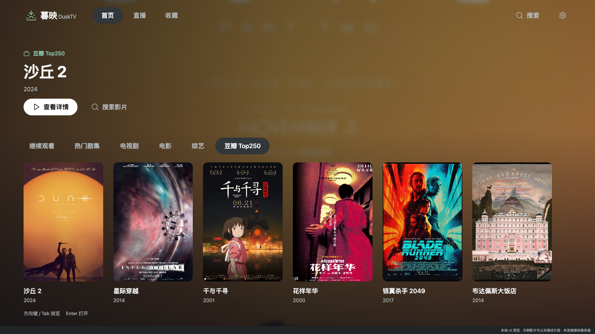
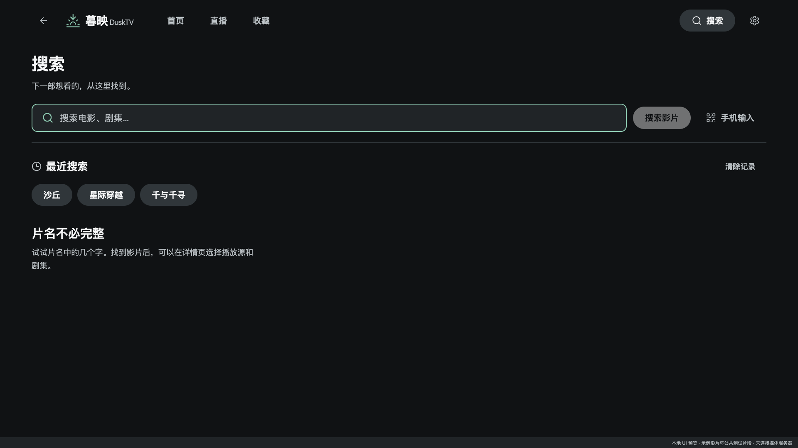
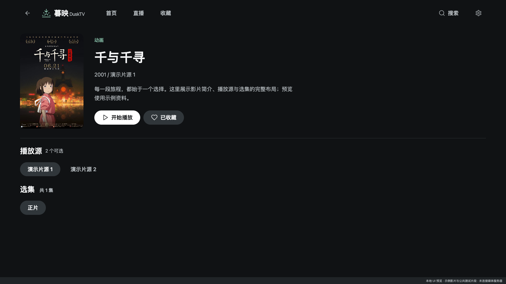
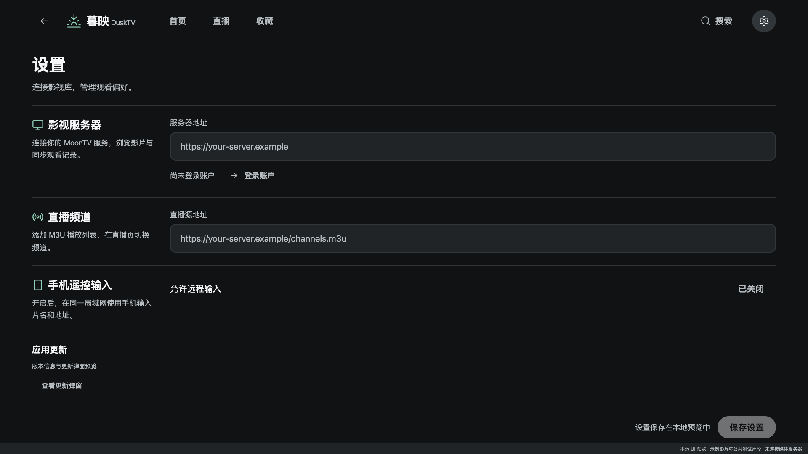

# 暮映 · DuskTV

[简体中文](README.md) | **English**

A TV and browser client for MoonTV / LunaTV. Forked from [orion-lib/OrionTV](https://github.com/orion-lib/OrionTV), with upstream history and attribution preserved.

DuskTV brings a shared dark cinema interface to the home screen, search, movie details, favorites, live TV, settings, and playback controls. Layouts adapt to both window width and height. The native app targets Android TV and Apple TV. The local browser client supports server login, search, favorites, watch-history synchronization, and MP4 / HLS playback. Its Video.js 10 React player provides a draggable timeline, volume, playback speed, fullscreen and picture-in-picture controls, and keyboard shortcuts, alongside DuskTV's episode, source, and intro/outro controls.

## Interface preview

These screenshots use isolated demo data and render the shared TV interface components in a 1920 × 1080 browser window. **They are not Android TV or Apple TV device captures.** Native playback controls differ from the browser player; device screenshots will be added after hardware verification. The README is available in Chinese and English; the application interface is currently primarily Chinese.

### Home

Full-page poster artwork, category navigation, and a movie shelf.



### Search and movie details

| Search | Movie details |
| --- | --- |
|  |  |

### Settings



## Local browser client

Requires Node.js 20.19+ or 22.12+.

```sh
cd preview
npm ci
npm run dev
```

Open `http://127.0.0.1:4318/`, enter your server address in Settings, and sign in. You can also set the address in the untracked `preview/.env.local` file:

```dotenv
DUSK_SERVER_URL=https://your-server.example
```

- The default entry uses your server's data. `?demo=1#home` opens an isolated interface demo.
- The local API bridge listens on loopback only and handles server sessions and cross-origin media requests. Passwords are not written to project files or browser storage. Upstream cookies stay in the local server's memory; restarting it requires signing in again.
- `npm run build` builds the browser client. `npm run preview` starts a local preview with the API bridge. Copying `dist/` to a static host alone does not provide authentication or media bridging.
- Do not commit `.env.local`, private server addresses, credentials, or screenshots containing personal data. Documentation screenshots use isolated demo data only.

## Native TV app

Requires Yarn 1.x. Android builds also need the Android SDK and JDK; Apple TV builds require a full Xcode installation.

```sh
yarn install --frozen-lockfile
yarn start       # Metro in TV mode
yarn prebuild    # Generate native projects
yarn android     # Android TV
yarn ios         # Apple TV
```

The native application name is “暮映 · DuskTV”, its application ID is `com.zhouhaojiang.dusktv`, and its deep-link scheme is `dusktv://`. Updates point to this repository. Automatic update checks are disabled until the first official release; the app will not install upstream OrionTV update packages.

## Project structure

- `app/`: Expo Router screens and native application integration.
- `components/cinema/`: Shared navigation, forms, lists, dialogs, and page layouts.
- `components/home/`: Cinema home screen.
- `stores/`, `services/`: Native state, API, storage, and playback logic.
- `preview/`: Browser client reusing the shared interface, local API bridge, and demo.

## Validation

```sh
yarn typecheck
yarn jest --runInBand components/__tests__/SearchFlow.test.tsx components/__tests__/SettingsFlow.test.tsx
cd preview
npm run test:bridge
npm run build
npm run qa
npm run qa:connected
```

Browser QA requires a local Chrome installation. Connected-mode QA also requires FFmpeg and uses an isolated local test service, not a real account. Set `PREVIEW_URL` to use another local port. A successful JavaScript/Hermes export does not constitute an APK/IPA build or physical TV verification.

## Contributing

The default branch, `main`, is protected. Submit changes through a pull request from a feature branch and resolve review discussions before merging. Force pushes and deletion of the default branch are disabled. Keep both README translations in sync; they share screenshots from `docs/screenshots/`.

## Upstream and licensing

DuskTV is forked from [OrionTV](https://github.com/orion-lib/OrionTV). Thank you to its authors and contributors. The upstream README identifies the license as MIT; this repository preserves the upstream licensing notice and Git history.

DuskTV is a video search and playback tool. It does not store, upload, or distribute films. Video content comes from third-party services configured by the user. Please contact the relevant content provider about infringing content.

Thanks to [MoonTV](https://github.com/senshinya/MoonTV), [LibreTV](https://github.com/LibreSpark/LibreTV), [React Native TVOS](https://github.com/react-native-tvos/react-native-tvos), and the upstream contributors.
