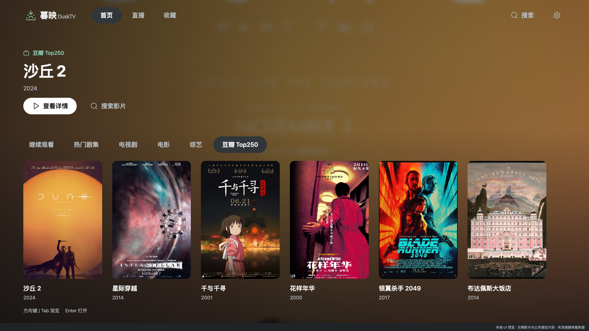
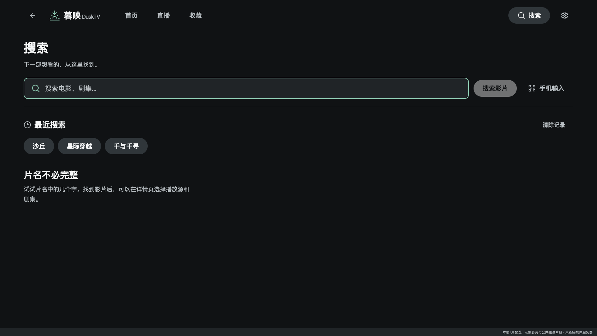
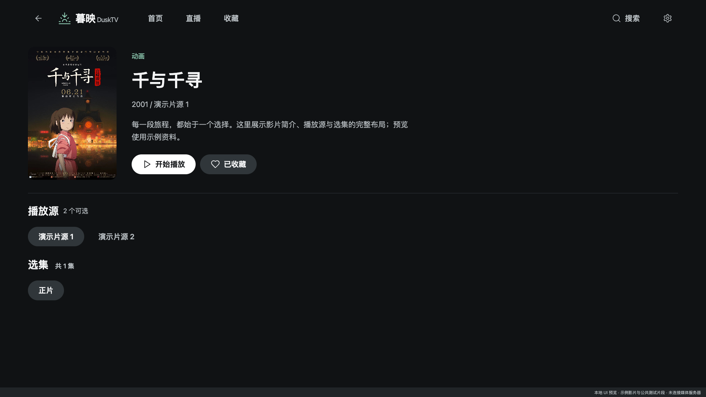
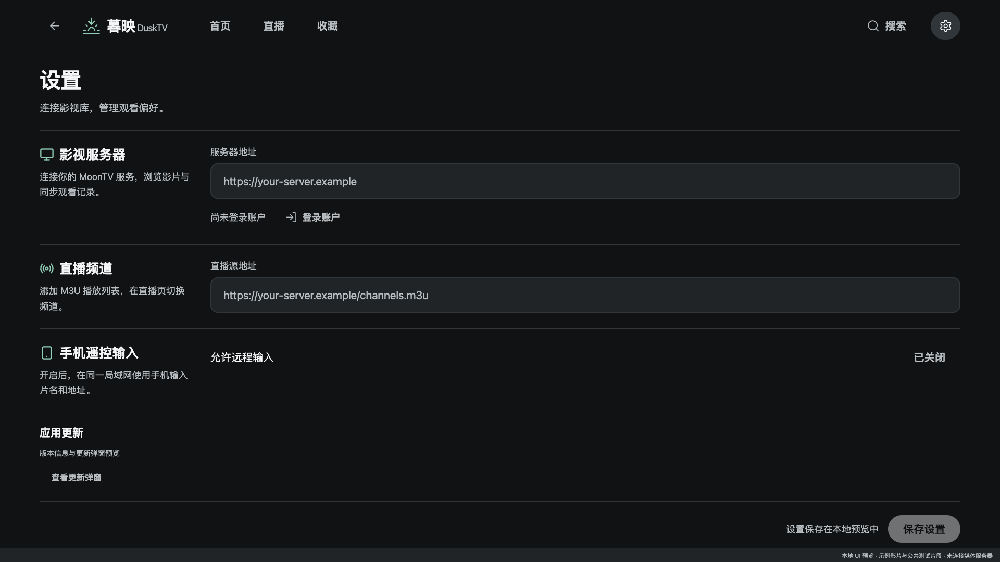

# 暮映 · DuskTV

**简体中文** | [English](README.en.md)

连接 MoonTV / LunaTV 的电视与浏览器播放器。基于 [orion-lib/OrionTV](https://github.com/orion-lib/OrionTV) fork 开发，保留上游历史与来源说明。

DuskTV 使用统一的深色影院界面：首页、搜索、影片详情、收藏、直播、设置和播放控制按照窗口宽度与高度调整比例。原生端支持 Android TV / Apple TV；本地浏览器客户端支持真实登录、搜索、收藏和观看记录同步，以及 MP4 / HLS 播放。浏览器播放器采用 Video.js 10 React 的完整控制栏，提供可拖动进度、音量、倍速、全屏、画中画与键盘操作；选集、换源及片头片尾设置保留暮映业务适配。

## 界面预览

以下截图使用独立演示数据，在 1920 × 1080 浏览器窗口中渲染与电视端共享的界面组件，**不是 Android TV / Apple TV 真机截图**。原生播放控件与浏览器播放器不同；电视真机截图将在完成设备验证后补充。README 提供中英双语，应用界面目前以中文为主。

### 首页

全页海报背景、分类导航与影片列表。



### 搜索与影片详情

| 搜索 | 影片详情 |
| --- | --- |
|  |  |

### 设置



## 本地浏览器客户端

需要 Node.js 20.19+ 或 22.12+。

```sh
cd preview
npm ci
npm run dev
```

打开 `http://127.0.0.1:4318/`，在设置中填写自己的服务器地址并登录。也可以在未提交的 `preview/.env.local` 中设置：

```dotenv
DUSK_SERVER_URL=https://your-server.example
```

- 正常入口使用真实服务器数据；`?demo=1#home` 是独立的界面演示。
- 本地接口桥接仅监听回环地址，处理服务器会话与媒体跨域。密码不写入项目或浏览器存储；上游 Cookie 仅保留在本地服务的内存中，重启服务后需重新登录。
- `npm run build` 生成浏览器产物，`npm run preview` 启动带接口桥接的本地预览。仅复制 `dist/` 到静态主机不能提供真实登录和媒体桥接。
- 不要提交自己的 `.env.local`、私人服务器地址、登录信息或含个人数据的运行截图。文档截图仅使用独立演示数据。

## 原生电视端

需要 Yarn 1.x；Android 构建需要 Android SDK/JDK，Apple TV 构建需要完整 Xcode。

```sh
yarn install --frozen-lockfile
yarn start       # TV 模式 Metro
yarn prebuild   # 生成原生工程
yarn android    # Android TV
yarn ios        # Apple TV
```

原生应用名称为「暮映 · DuskTV」，应用标识为 `com.zhouhaojiang.dusktv`，深链协议为 `dusktv://`。更新地址指向本仓库，首次正式发行前关闭自动检查，不会安装上游 OrionTV 的更新包。

## 项目结构

- `app/`：Expo Router 页面与原生业务适配。
- `components/cinema/`：共享导航、表单、列表、弹窗和页面布局。
- `components/home/`：影院首页。
- `stores/`、`services/`：原生状态、接口、存储与播放逻辑。
- `preview/`：复用共享界面的浏览器客户端、本地接口桥接与演示。

## 验证

```sh
yarn typecheck
yarn jest --runInBand components/__tests__/SearchFlow.test.tsx components/__tests__/SettingsFlow.test.tsx
cd preview
npm run test:bridge
npm run build
npm run qa
npm run qa:connected
```

浏览器 QA 需要本机 Chrome；连接模式 QA 还需要 FFmpeg，使用隔离的本地测试服务，不使用真实账户。可设置 `PREVIEW_URL` 指向其他本地端口。JavaScript/Hermes 导出不等同于 APK/IPA 构建或电视真机验证。

## 贡献

默认分支 `main` 受保护。请从功能分支提交 PR，合并前解决讨论；禁止强推和删除默认分支。文档改动请同步更新中英文 README，两份文档共用 `docs/screenshots/` 中的截图。

## 上游与许可

本项目 fork 自 [OrionTV](https://github.com/orion-lib/OrionTV)，感谢原作者和贡献者。上游 README 标注采用 MIT 许可证；本仓库保留上游的许可说明与 Git 历史。

DuskTV 仅作为视频搜索与播放工具，不存储、上传或分发影片；视频内容来自用户配置的第三方服务。如有侵权内容，请联系相应内容提供方。

感谢 [MoonTV](https://github.com/senshinya/MoonTV)、[LibreTV](https://github.com/LibreSpark/LibreTV)、[React Native TVOS](https://github.com/react-native-tvos/react-native-tvos) 以及上游项目的贡献者。
